# Ghid vizual al interfeței — Multi-Bus Gateway

> Ghid în română, cu capturi din versiunea 3.92 (octombrie 2026). Referința
> completă, la zi, este [MANUAL.ro.md](MANUAL.ro.md) (română) /
> [MANUAL.md](MANUAL.md) (engleză).

Un tur ilustrat al fiecărei pagini, sub-pagini și tab din interfața web, cu note
explicative pentru operator/integrator. Capturile sunt făcute pe un **gateway
demo** cu dispozitive simulate, pe o rețea proprie de documentație
(`192.0.2.0/24`), fără nicio adresă, nume sau loc real (amplasamentul demo este
Paris):

- un contor de rețea **Janitza UMG 512-PRO** (Modbus TCP);
- o **Instalație** pe acoperiș („Roof PV”) cu trei invertoare Fronius și
  totalurile de site, citite prin Solar API (HTTP);
- un banc de baterii („Battery bank”) cu două pachete Seplos, ascultate
  **listen-only** (`rtu_tap`);
- un UPS („Server room UPS”) măsurat de două **Eastron SDM630** (intrare /
  ieșire) — un Dispozitiv fără conexiune proprie (*Doar contoare*);
- o pompă de piscină pe un convertizor **Delta VFD-EL**, cu comenzi;
- un **Contor virtual** EM24 servit din contorul de rețea;
- o regulă pentru pompă, în mod **shadow**;
- InfluxDB pentru Istoric și un invertor SunSpec fictiv („Demo Solar
  DS-8000-3P”) pentru scanarea SunSpec.

Interfața din capturi este în engleză; mai jos, butoanele și tab-urile poartă
numele din interfața în română, cu cel englezesc în paranteză acolo unde ajută.
Bara de sus e identică peste tot: navigarea între pagini, indicatorii de stare
(Dev / MQTT / DB / VM — verde = ok), selectorul de limbă și comutatorul de temă
(clar/întunecat). Bara de jos arată conexiunea, cadențele de poll (Realtime /
Normal / Slow), ora ultimului update și versiunea.

---

## 1. Tablou de bord (Dashboard)

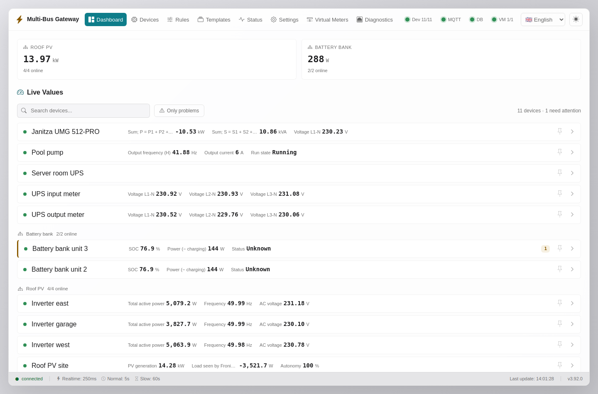

Sus, **banda de site** — povestea energiei, nu a gateway-ului: câte un card pe
**Instalație** (aici „Roof PV” cu puterea de acum și „Battery bank”, fiecare cu
unitățile online) plus Dispozitivele **prinse** cu pioneza de pe rândul lor.
Pe un card prins alegi ce metrică arată, o etichetă proprie și ordinea. Click
pe card te duce la Instalație sau la Dispozitiv.

Dedesubt, **Valori live** (Live Values) — vederea de flotă: un rând per
Dispozitiv, cu punctul de sănătate, primele valori ca metrici-erou și, la
nevoie, numărul alarmelor (insigna de pe „Battery bank unit 3”). Dispozitivele
de sine stătătoare stau sus, unitățile Instalațiilor grupate sub numele ei.
Căutarea și filtrul **Doar probleme** îngustează lista; în dreapta, câte
Dispozitive sunt și câte cer atenție. Click pe un rând deschide spațiul de lucru
al Dispozitivului (§20).

---

## 2. Monitor live (Dispozitive → unitate → Diagnostic → Monitor)

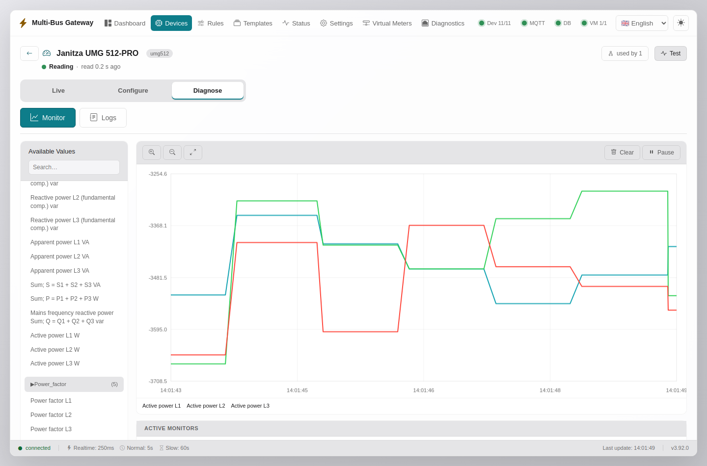

Spațiul de lucru al unui Dispozitiv are trei grupuri de tab-uri: **Live**
(Prezentare, Istoric, Energie, Calitatea energiei), **Configurare** (Conexiune,
Măsurători, Calculate, Comenzi, Contoare, Ieșiri, Atribute) și **Diagnostic**
(Monitor, Jurnal) — fiecare Dispozitiv arată doar tab-urile care i se potrivesc.
Monitorul desenează în timp real valorile alese din lista din stânga (căutare,
grupate pe Categorie) — aici puterile active L1/L2/L3 ale contorului Janitza —
cu zoom, **Șterge** (Clear) și **Pauză** (Pause); sub grafic, tabelul
monitoarelor active. Butonul **Test** din antet face o citire de probă, iar
**folosit de 1** arată ce depinde de acest Dispozitiv (aici Contorul virtual).

---

## 3. Istoric (Dispozitive → unitate → Live → Istoric)

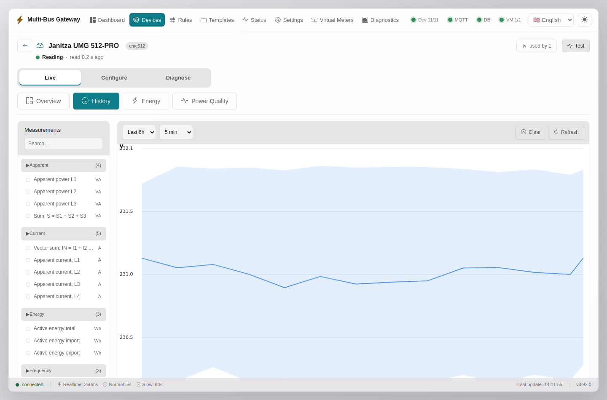

Grafice din datele stocate în InfluxDB: alegi măsurătorile din lista din stânga
(grupate pe Categorie, cu unitatea de măsură), fereastra de timp (aici ultimele
6 h) și pasul de agregare (5 min). Util pentru a vedea evoluția (tensiuni,
putere) fără a deschide Grafana.

---

## 4. Dispozitive (Devices)

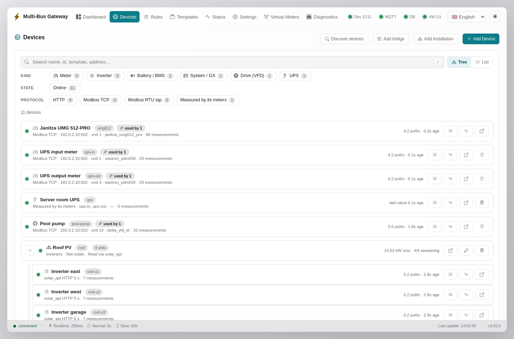

Toate sursele, cu sănătatea live a fiecăreia. Sus, căutarea, filtrele pe **Tip**
(contor, invertor, baterie/BMS, sistem/GX, convertizor, UPS), **Stare** și
**Protocol** (HTTP, Modbus TCP, Modbus RTU tap, *Măsurat de contoarele lui*) și
comutatorul **Arbore / Listă**. Fiecare rând arată protocolul, adresa, unitatea,
Șablonul, numărul de măsurători, rata de poll și vârsta ultimei citiri; insigna
**folosit de N** spune ce depinde de el (un Contor virtual, o regulă, UPS-ul).
Instalațiile („Roof PV”) își grupează unitățile dedesubt, cu puterea de acum și
câte unități răspund.

Butoanele de sus: **Descoperă dispozitive**, **Adaugă bridge**, **Adaugă
instalație** și **Adaugă dispozitiv** (wizard-ul din §18). Pe fiecare rând:
măsurătorile, monitorul și deschiderea spațiului de lucru (§19, §20).

---

## 5. Șabloane (Templates)

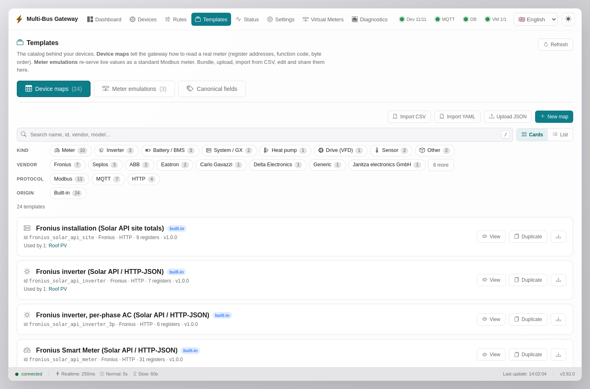

Catalogul din spatele Dispozitivelor, în trei tab-uri: **Hărți dispozitiv**
(Device maps — cum se citește un echipament real: adrese, cod de funcție, ordinea
octeților), **Emulări contor** (Meter emulations — ce poate servi un Contor
virtual) și **Câmpuri canonice**. Filtre pe tip, producător, protocol și
origine; fiecare card arată id-ul, protocolul, numărul de registre, versiunea și
**Folosit de** (aici Șabloanele Fronius folosite de „Roof PV”). Pe un Șablon:
**Vezi**, **Duplică** și descărcare. Sus: **Importă CSV**, **Importă YAML**,
**Încarcă JSON** și **Hartă nouă**.

---

## 6. Stare (Status)

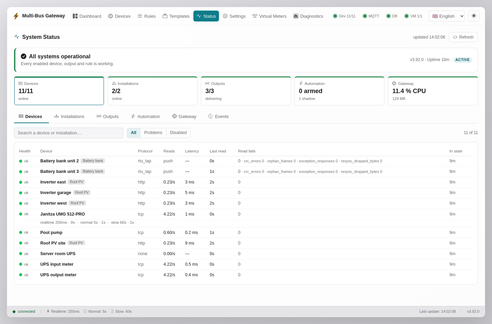

Sănătatea sistemului la un loc. Sus, verdictul (aici „All systems operational”)
cu versiunea și uptime-ul, apoi cardurile de rezumat: Dispozitive, Instalații,
Ieșiri, Automatizări (aici 0 armate, 1 shadow) și Gateway. Când ceva nu e în
regulă, **Necesită atenție** apare sub verdict și listează fiecare problemă cu
un buton de deschidere. Dedesubt, tab-urile Dispozitive,
Instalații, Ieșiri, Automatizări, Gateway și Evenimente; tabelul de Dispozitive
arată protocolul, rata de citire, latența, ultima citire și **citirile eșuate**
(pentru `rtu_tap`: erori CRC, cadre orfane, răspunsuri de excepție). E prima
pagină la care te uiți când ceva nu merge — îți spune *care strat* e bolnav.

---

## 7. Contoare virtuale (Virtual Meters)

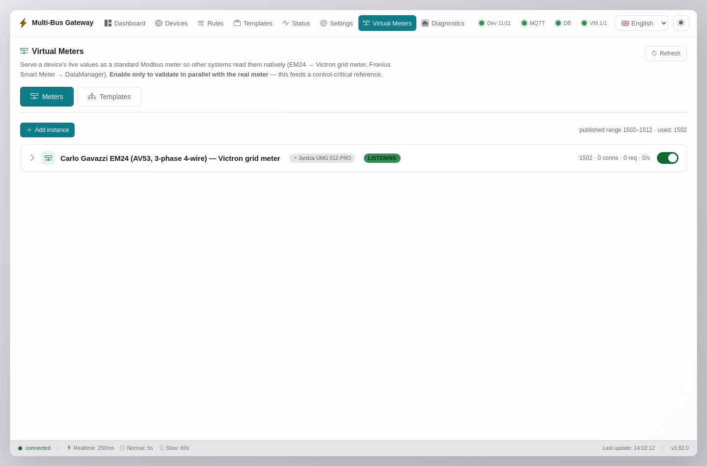

Valorile live ale unui Dispozitiv servite mai departe ca un contor Modbus
standard, ca alt sistem să le citească nativ — aici un EM24 („Victron grid
meter”) alimentat din contorul Janitza, pe portul 1502, care ascultă
(**LISTENING**), cu conexiunile, cererile și rata lui. Comutatorul de pe rând îl
pornește/oprește; **Adaugă instanță** creează unul nou în intervalul de porturi
publicat. Pagina o spune explicit: activează-l doar ca să-l validezi în paralel
cu contorul real — alimentează o referință critică pentru control. Rândul se
desface pentru politica de staleness (absența nu e servită niciodată ca 0),
previzualizarea valorilor și statisticile de comunicație.

---

## 8. Diagnostic — Monitor magistrală

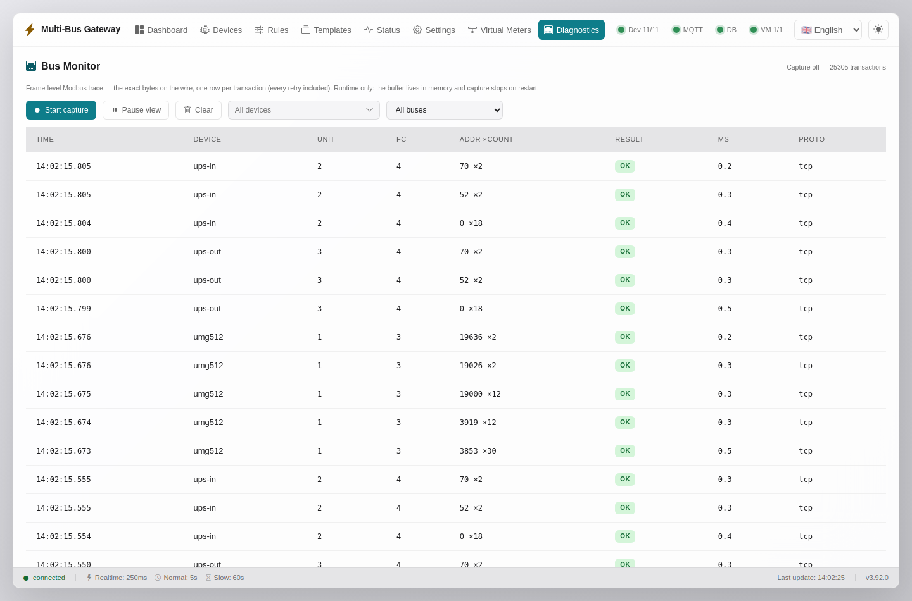

Trace Modbus **la nivel de cadru** — un rând per tranzacție (fiecare retry
inclus): ora, Dispozitivul, unitatea, FC, adresa × numărul de registre,
rezultatul (OK / excepție / timeout / CRC), latența și protocolul. **Oprește
captura**, **Pauză afișare**, **Golește** și filtrele pe Dispozitiv și pe
magistrală. Un click pe rând deschide octeții bruți. Doar la runtime — bufferul
e în memorie, captura se oprește la restart. Instrumentul #1 la comisionarea
unei magistrale noi.

---

## 9. Diagnostic — Sondă registru (endianness)

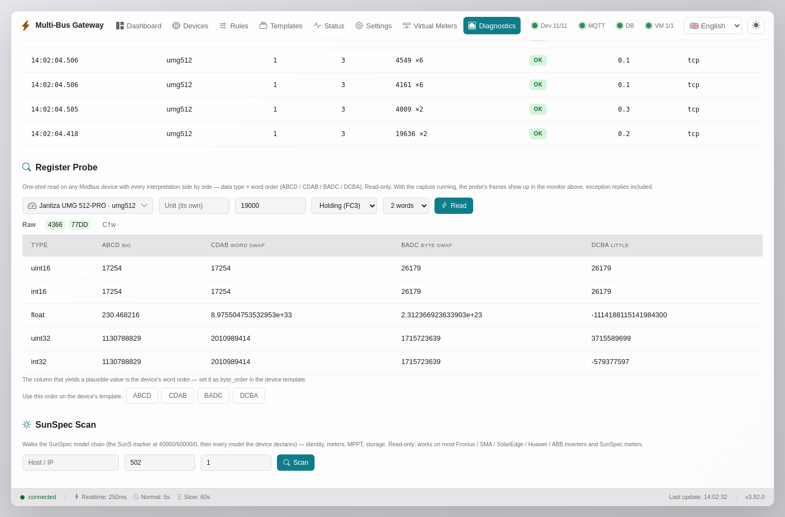

Citire one-shot pe **orice** Dispozitiv Modbus (aici Janitza, registrul 19000,
Holding FC3, 2 cuvinte), cu **toate interpretările una lângă alta** — tip de date
× ordinea cuvintelor (ABCD / CDAB / BADC / DCBA) — plus hex-ul brut și ASCII.
Coloana care dă o valoare plauzibilă (aici `float` ABCD = 230,66 V) e ordinea
corectă; butoanele de dedesubt o aplică pe Șablonul Dispozitivului. Doar citire;
cu captura pornită, cadrele sondei apar în monitorul de deasupra.

---

## 10. Diagnostic — Scanare SunSpec

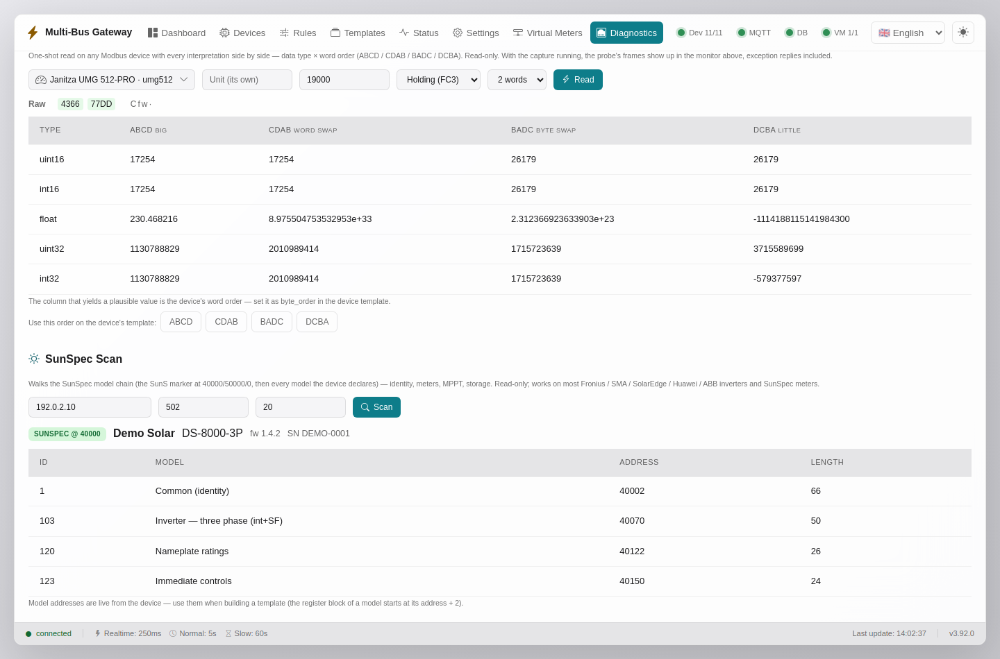

Parcurge lanțul de modele SunSpec (markerul SunS la 40000/50000/0, apoi fiecare
model declarat) — aici host `192.0.2.10`, port 502, unitatea 20: invertorul
fictiv „Demo Solar DS-8000-3P”, cu firmware și serie, și modelele 1 (identitate),
103 (invertor trifazat), 120 (date nominale) și 123 (comenzi imediate), fiecare
cu adresa și lungimea. Doar citire; adresele vin live de la dispozitiv și se
folosesc la construirea unui Șablon.

---

## 11. Setări — MQTT

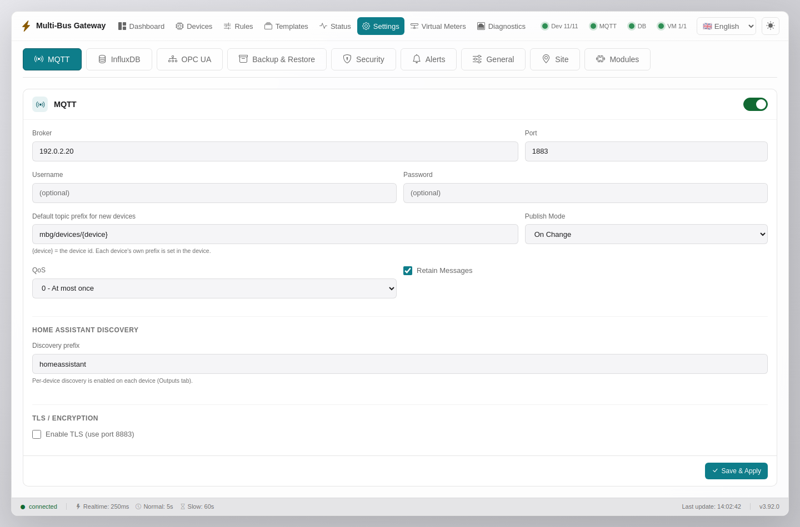

Tab-urile Setărilor: MQTT, InfluxDB, OPC UA, Backup și restaurare, Securitate,
Alerte, General, Site / Amplasament și Module. Aici: brokerul (adresă, port,
utilizator/parolă), **prefixul implicit de topic** pentru Dispozitivele noi
(`mbg/devices/{device}` — fiecare Dispozitiv își păstrează prefixul propriu),
modul de publicare (*On Change*), QoS, retain, prefixul pentru **Home Assistant
discovery** (activat per Dispozitiv, din tab-ul Ieșiri) și TLS. **Salvează și
aplică** reconectează live.

---

## 12. Setări — InfluxDB

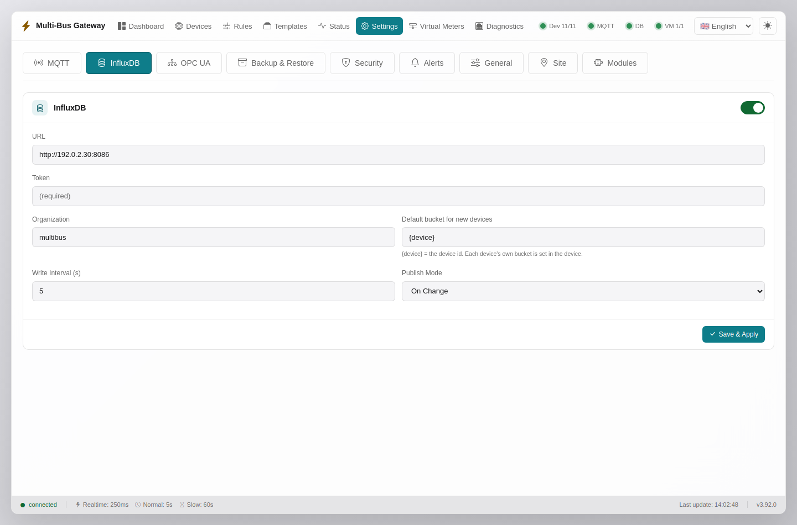

Conexiunea la InfluxDB (URL, token, organizație), **bucket-ul implicit** pentru
Dispozitivele noi (`{device}` — fiecare Dispozitiv își are bucket-ul lui),
intervalul de scriere și modul de publicare. Dacă InfluxDB pică, punctele se țin
într-un buffer și se rejoacă cu timestamp-ul original la reconectare (reglajele
sunt în configurație — vezi MANUAL.ro.md).

---

## 13. Setări — Backup și restaurare + Snapshot-uri

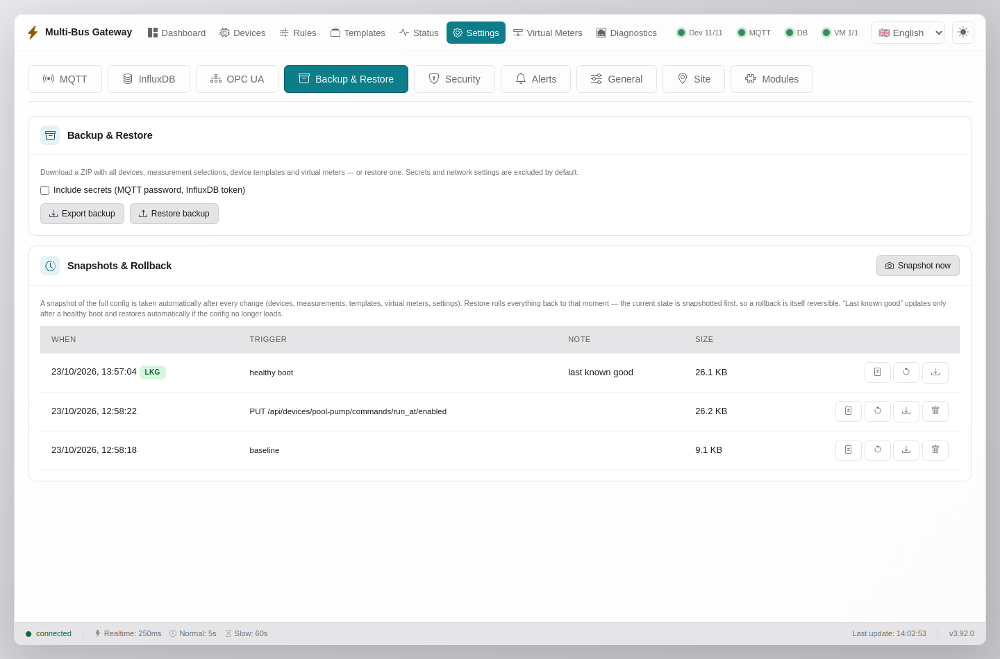

Sus: **Exportă backup** / **Restaurează backup** — un ZIP cu Dispozitive,
măsurători, Șabloane și Contoare virtuale; secretele și setările de rețea sunt
excluse implicit (bifa **Include secretele** le adaugă). Dedesubt,
**Snapshot-uri și revenire**: un snapshot al configurației se face automat după
fiecare schimbare (coloana *Trigger* spune care), plus **Snapshot acum**. Pe
fiecare: diff, revenire, descărcare, ștergere. Revenirea salvează întâi starea
curentă, deci e reversibilă. **LKG** („last known good”) se actualizează doar
după un boot sănătos și se restaurează automat dacă configurația nu se mai
încarcă.

---

## 14. Setări — Securitate

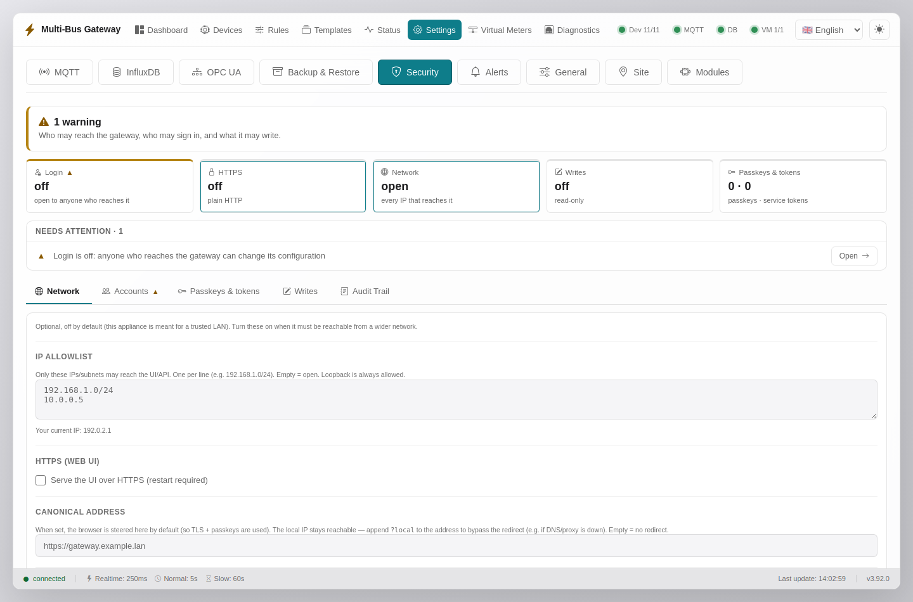

Sus, verdictul și cinci carduri: **Login**, **HTTPS**, **Rețea**, **Scrieri** și
**Passkeys și tokenuri** — pe demo totul e deschis (login oprit, HTTP simplu,
orice IP, scrieri doar-citire), deci **Necesită atenție** semnalează că oricine
ajunge la gateway îi poate schimba configurația. Tab-urile: **Rețea** (IP
allowlist, HTTPS pentru UI, adresa canonică cu portița `?local`), **Conturi**
(login + roluri admin / operator / viewer), **Passkeys și tokenuri**, **Scrieri**
(comutatorul general pentru scrierile Modbus) și **Jurnal de audit**. Totul e
opțional: aparatul e gândit pentru un LAN de încredere și pornești securitatea
când iese din el.

---

## 15. Setări — Securitate: Jurnal de audit

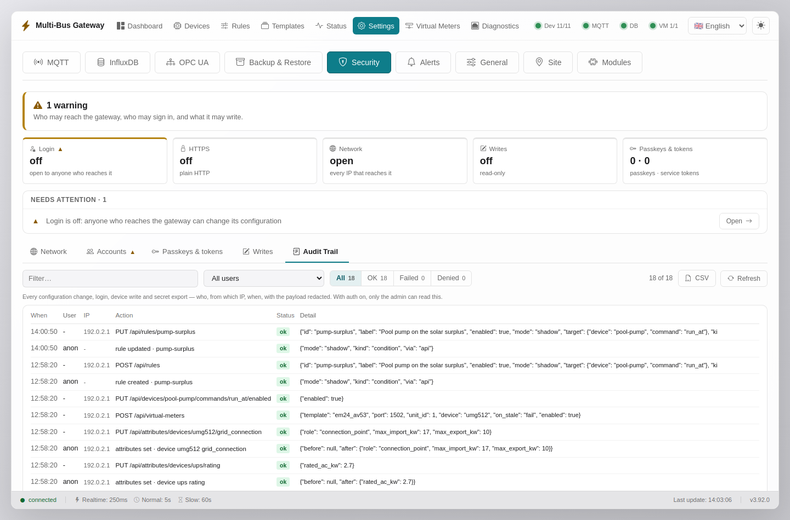

Fiecare schimbare de configurație, login, scriere pe dispozitiv și export de
secrete — cine, de la ce IP, când, cu payload-ul redactat. Filtru text, filtru
pe utilizator, pe rezultat (OK / Failed / Denied), export CSV. În captură:
crearea regulii pompei, activarea comenzii, Contorul virtual și atributele
(punctul de conectare, puterea UPS-ului, locația). Cu login-ul pornit, doar
rolul admin poate citi jurnalul.

---

## 16. Setări — Alerte

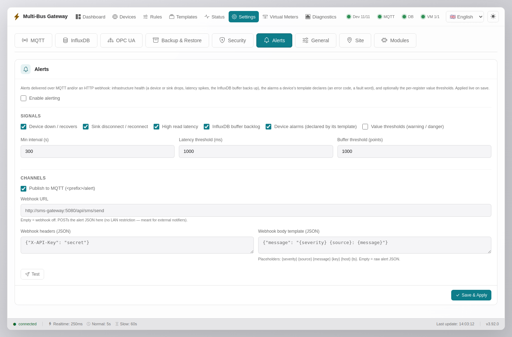

Alerte trimise pe MQTT (`<prefix>/alert`) și/sau printr-un webhook HTTP.
**Semnale**: Dispozitiv căzut/revenit, sink deconectat/reconectat, latență mare,
buffer InfluxDB în urmă, alarmele declarate de Șablonul Dispozitivului și,
opțional, pragurile per valoare; plus intervalul minim și pragurile de latență și
de buffer. **Canale**: MQTT și webhook-ul (URL, antete JSON, corp JSON cu
placeholdere `{severity} {source} {message}` …). **Test** trimite o alertă de
probă; **Activează alertele** e bifa generală.

---

## 17. Setări — General

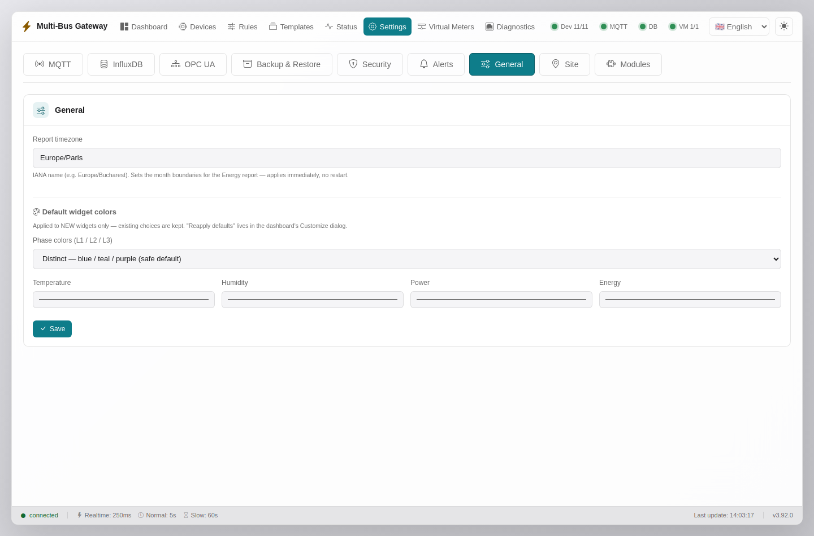

**Fus orar rapoarte** (nume IANA, aici `Europe/Paris`) — stabilește granițele
lunilor în raportul de Energie, fără restart. **Culori default pentru
widget-uri**: culorile fazelor L1/L2/L3 (implicit *Distinct*) și pe Categorie
(temperatură, umiditate, putere, energie) — se aplică doar widget-urilor noi.

---

## 18. Wizard Adaugă dispozitiv — pasul 1 (Conexiune)

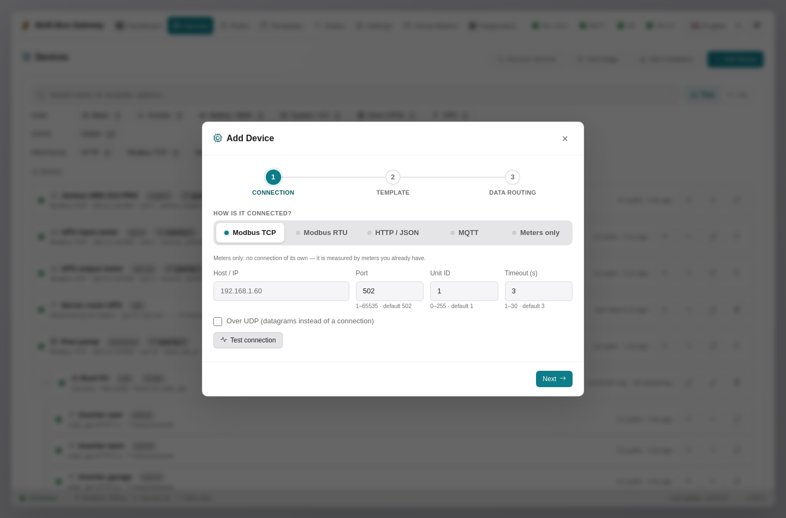

Trei pași: **Conexiune**, **Șablon**, **Rutare date**. La pasul 1 alegi cum e
conectat: Modbus TCP / Modbus RTU / HTTP/JSON / MQTT / **Doar contoare** (un
Dispozitiv fără conexiune proprie, măsurat de contoare pe care le ai deja — ca
UPS-ul din demo). Pentru Modbus TCP: host, port, Unit ID, timeout și opțiunea
**Prin UDP**. **Testează conexiunea** verifică live înainte să treci mai departe
cu **Înainte**.

---

## 19. Pagina Instalației

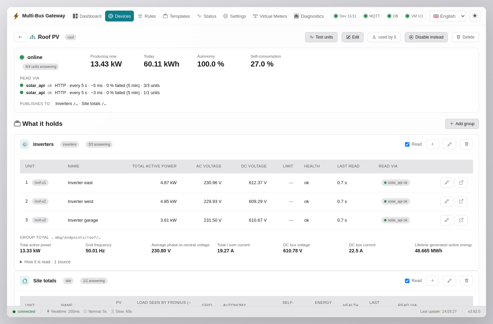

O **Instalație** este o sursă cu grupurile ei — aici „Roof PV”: trei invertoare
și totalurile de site. Cardul de sus: online, câte unități răspund, producția de
acum, energia de azi, autonomia și autoconsumul; **Citită prin** listează
fiecare cale (aici `solar_api`, HTTP la 5 s, latența, procentul de citiri eșuate
în ultimele 5 minute) și **Publică pe** spune unde ajung datele. Sub **Ce
conține**, fiecare grup are tabelul unităților (putere, tensiuni AC/DC, limită,
sănătate, ultima citire, sursa), totalul grupului publicat pe
`mbg/endpoints/roof/…` și **Cum e citit**. Sus: **Testează unitățile**,
**Editează**, **Dezactivează în schimb** (în loc de ștergere, când ceva o
folosește) și **Șterge**; **Adaugă grup** pentru un grup nou.

---

## 20. Spațiul de lucru al unei unități

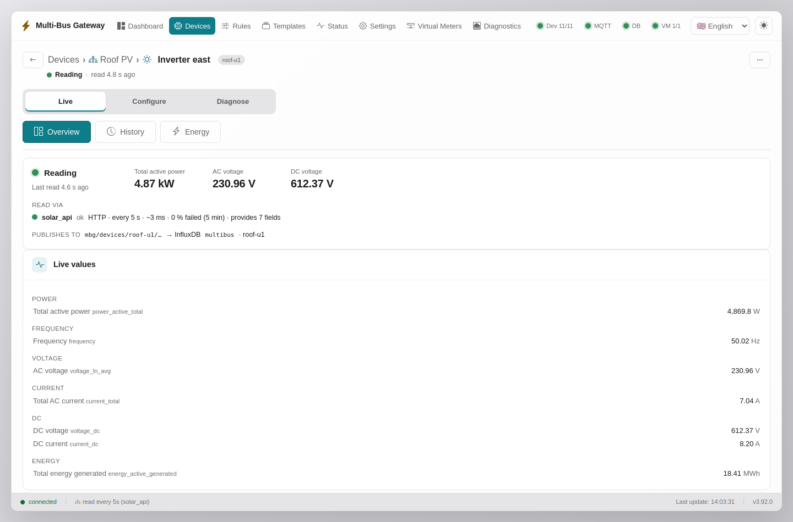

Fiecare unitate are pagina ei (aici `roof-u1`, „Inverter east”), cu firul de
navigare Dispozitive › Roof PV › unitate. Tab-ul **Prezentare** din grupul Live:
starea, valorile-cheie, **Citită prin** (sursa, cadența, latența, câte câmpuri
aduce), unde publică (topicul MQTT și bucket-ul InfluxDB), apoi **Valori live**
grupate pe Categorie, fiecare cu numele canonic alături. Grupurile Configurare și
Diagnostic sunt cele din §2.

---

## 21. Comenzi (Configurare → Comenzi)

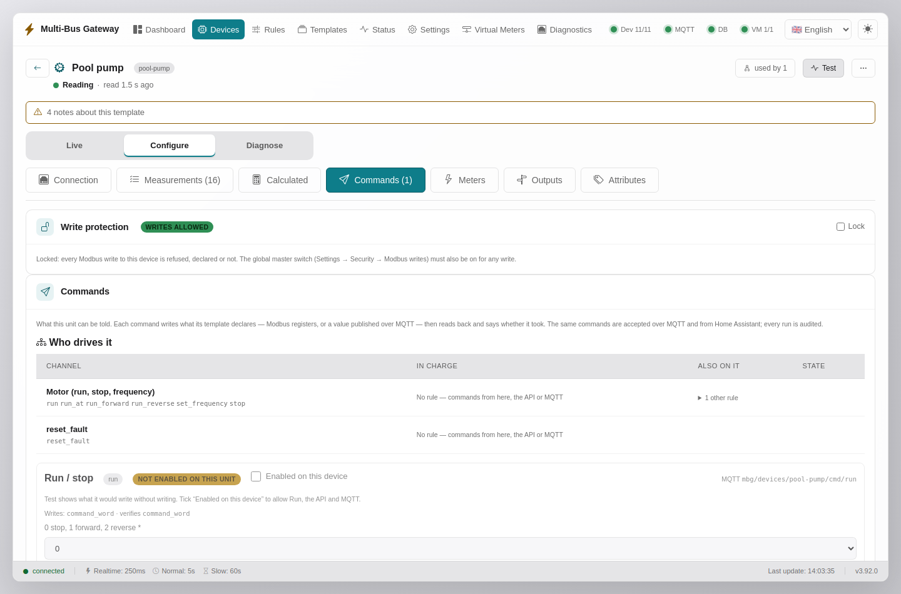

Pe pompa de piscină (Delta VFD-EL). Banda de sus deschide notele Șablonului.
**Protecție la scriere**: aici scrierile sunt permise; **Blochează** refuză orice
scriere Modbus pe acest Dispozitiv (comutatorul general din Securitate → Scrieri
trebuie și el pornit). **Cine o comandă** arată pe fiecare canal (motorul: run,
stop, frecvență; `reset_fault`) cine are controlul acum — o regulă sau comenzile
de aici, din API ori MQTT. Fiecare comandă are cardul ei: ce scrie, ce verifică
la citirea înapoi, parametrii și topicul MQTT (`mbg/devices/pool-pump/cmd/run`).
O comandă e **neactivată pe această unitate** până bifezi **Activată pe acest
dispozitiv**; până atunci **Test** arată doar ce ar scrie. Aceleași comenzi
merg pe MQTT și din Home Assistant; fiecare rulare e auditată.

---

## 22. Reguli

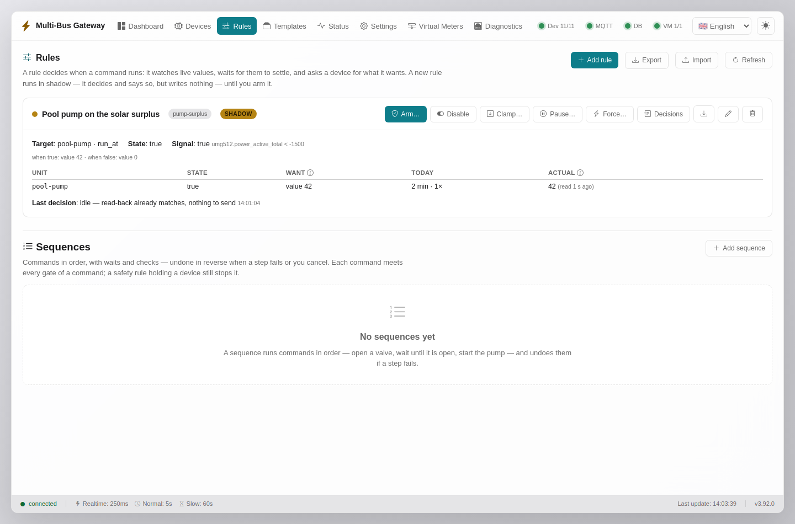

O regulă decide când rulează o comandă: urmărește valori live, așteaptă să se
stabilizeze și cere unui Dispozitiv ce vrea. Aici „Pool pump on the solar
surplus” ar trimite pompei `run_at` cu valoarea 42 când puterea la rețea scade
sub −1500 W (export) și 0 altfel. O regulă nouă rulează în **shadow** — decide și
spune ce ar face, dar nu scrie nimic — până o **Armezi** (Arm…). Semnalul
(`umg512.power_active_total < -1500`) e adevărat, regula vrea valoarea 42, iar
ultima decizie spune că nu are ce trimite: pompa deja merge la 42 Hz. Dacă o
regulă cere un câmp pe care Dispozitivul nu-l are, cardul o marchează **intrări
necunoscute** și propune numele corect. Tabelul: unitatea,
starea, ce vrea, timpul de azi și ce a citit înapoi. Intervențiile operatorului:
**Dezactivează**, **Plafon…**, **Pauză…**, **Forțează…**; **Decizii** deschide
istoricul. Sus: **Adaugă regulă**, **Export**, **Import**. Dedesubt,
**Secvențe**: comenzi în ordine, cu așteptări și verificări, anulate în ordine
inversă dacă un pas eșuează.

---

## Note

- **Roluri**: un *viewer* vede toate paginile (doar citire); un *operator* poate
  folosi uneltele de comisionare și scrie pe dispozitive, dar nu schimbă
  configurația; un *admin* poate tot, inclusiv jurnalul de audit și securitatea.
- **Temă**: comutatorul soare/lună (dreapta-sus) schimbă clar/întunecat; UI-ul
  respectă și preferința sistemului.
- **Limbă**: EN + RO incluse; se adaugă altele copiind un fișier din
  `ui/languages/`.
- **Mai departe**: [MANUAL.ro.md](MANUAL.ro.md), [API.md](API.md),
  [rules.md](rules.md), [opcua.md](opcua.md).

*Capturi generate pe versiunea 3.92, pe un gateway demo cu dispozitive simulate
și adrese de documentație (Playwright la 1440×950, temă clară, UI în engleză).*
