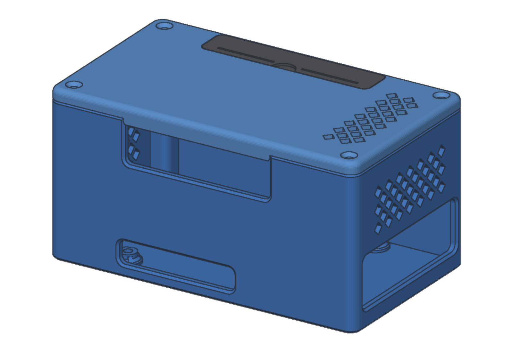
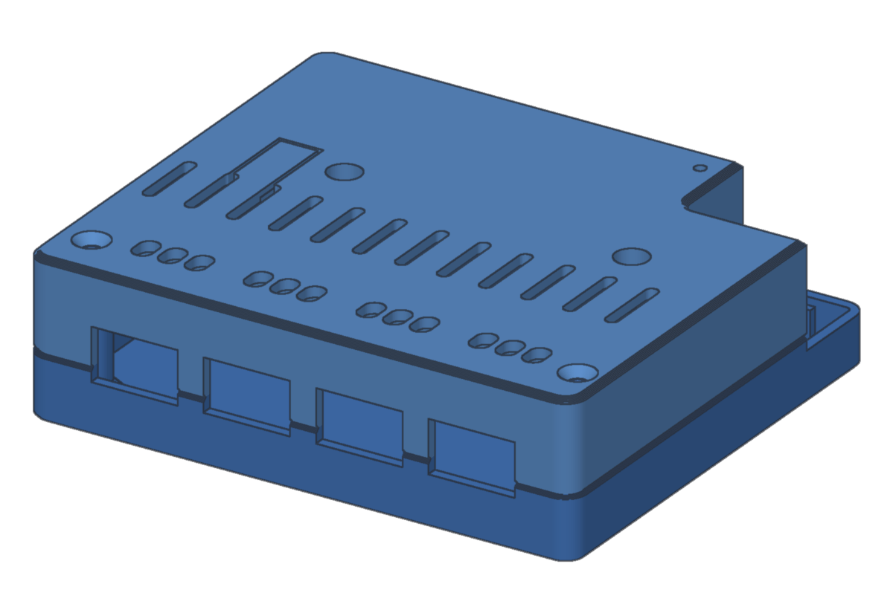
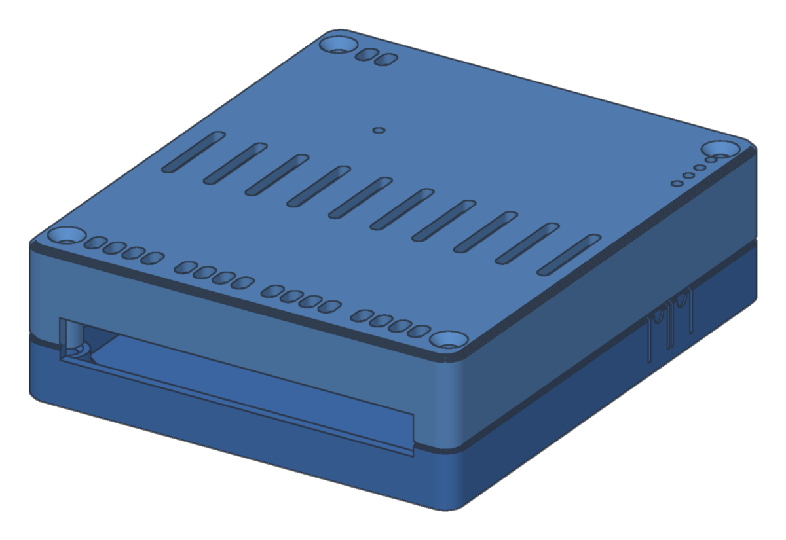

# Enclosures

3D-printable enclosures for the hardware Multi-Bus Gateway runs on. Each folder holds:

- the STL files;
- preview images;
- a README with the bill of materials, print settings and assembly steps.

| Enclosure | Hardware | Mounting |
|---|---|---|
| [rpi5-nvme-rs485-can](rpi5-nvme-rs485-can/) | Raspberry Pi 5 + NVMe HAT + Waveshare RS485 CAN HAT (B), 40 mm fan | 35 mm DIN rail, 3 modules |
| [lilygo-t-relay-4](lilygo-t-relay-4/) | LilyGO T-Relay ESP32, 4 relays | 35 mm DIN rail, 6 modules |
| [lilygo-t-connect](lilygo-t-connect/) | LilyGO T-Connect (ESP32-S3, isolated RS485 + CAN modules) | 35 mm DIN rail, 5 modules |

| | |
|---|---|
|  |  |

All designs here are licensed under [CC BY-SA 4.0](LICENSE.md); the gateway's software stays AGPL-3.0-or-later.
