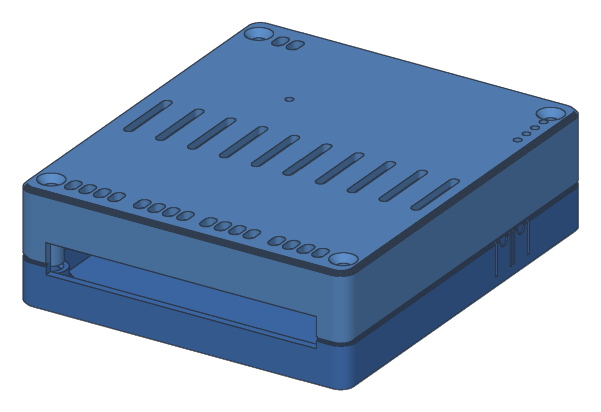
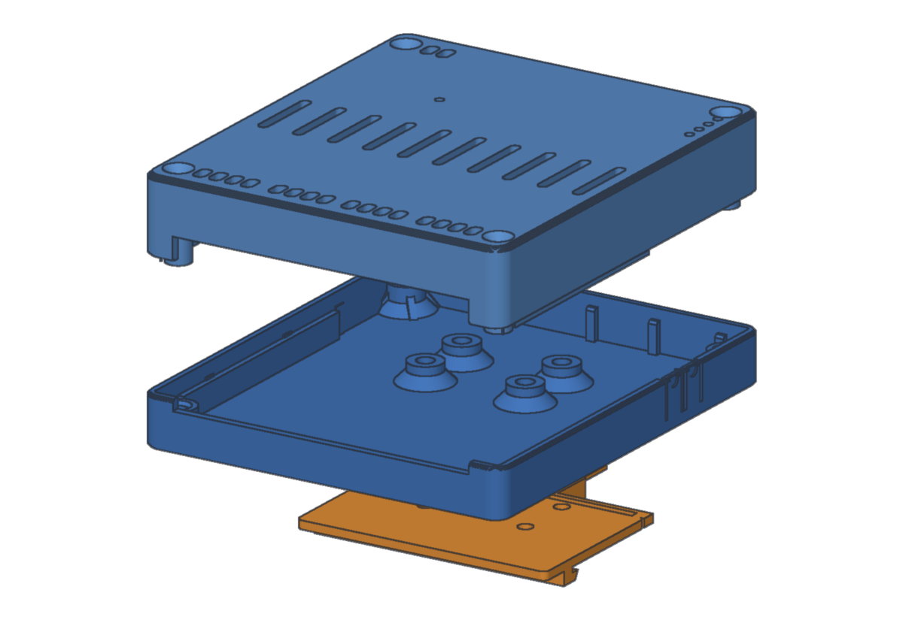
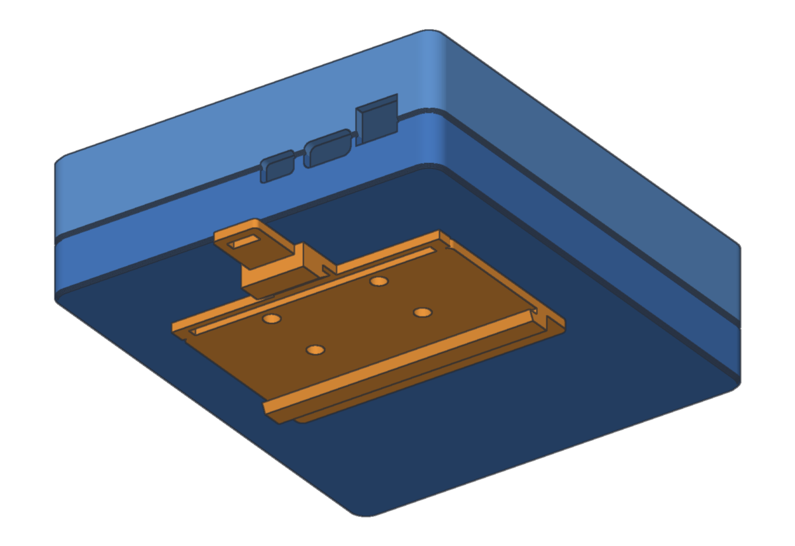
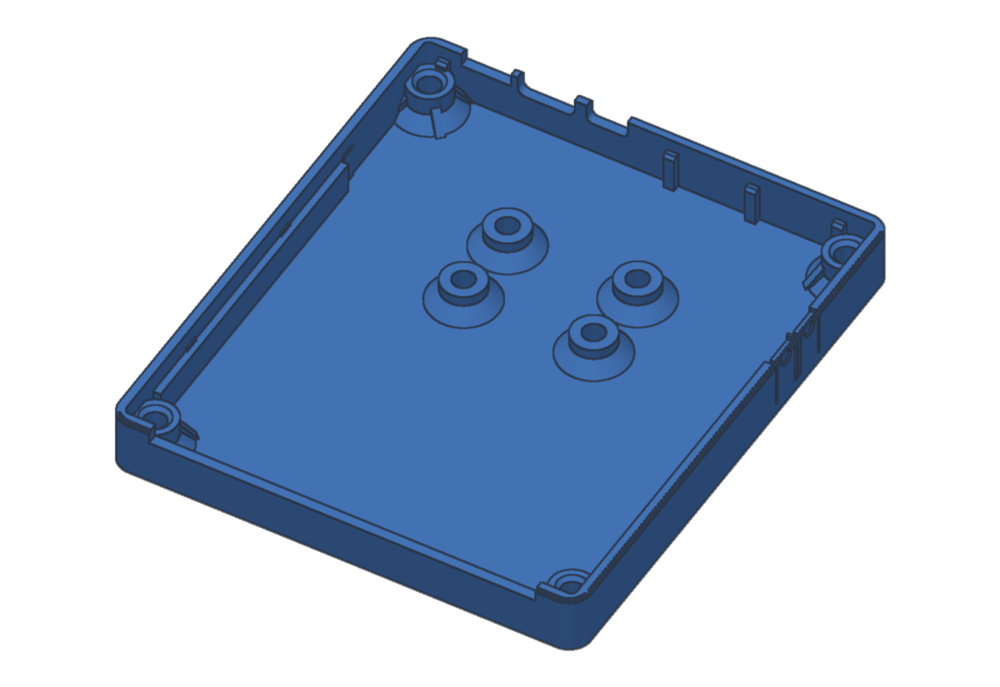
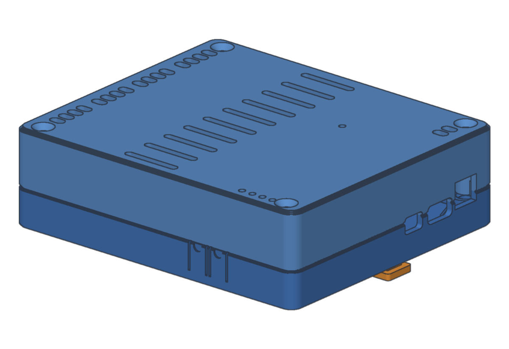
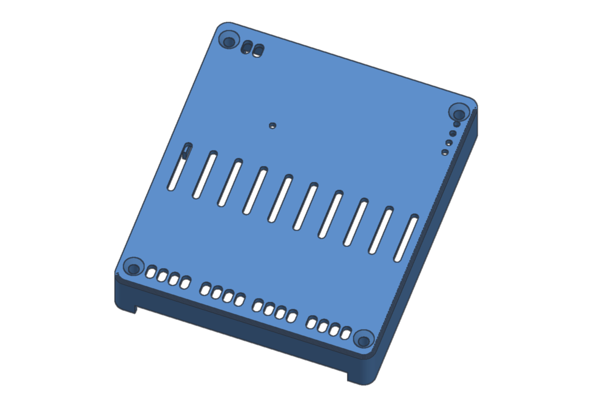
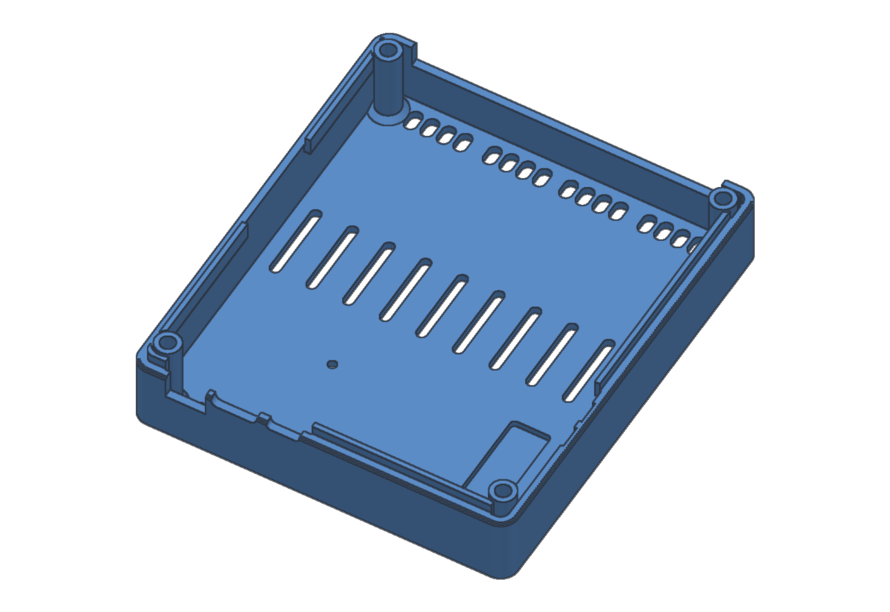
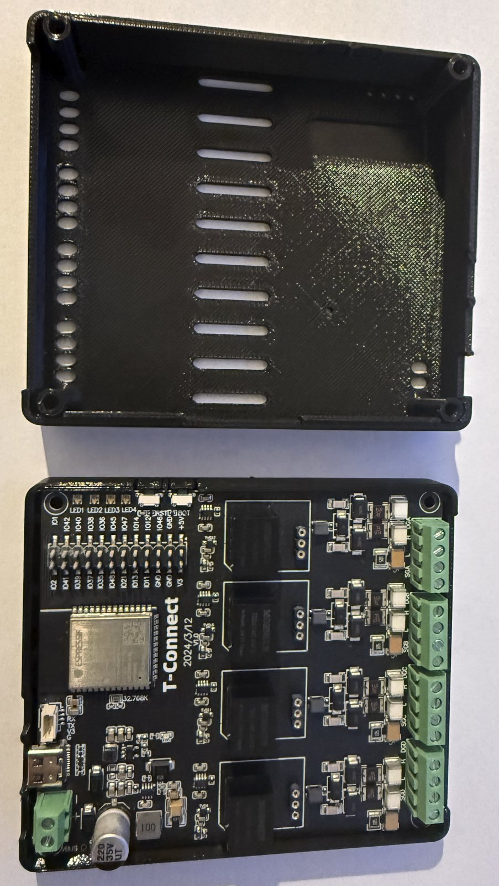

# LilyGO T-Connect (ESP32-S3, RS485 + CAN) — DIN-rail enclosure

A 3D-printable enclosure for the **LilyGO T-Connect V1.0**: an ESP32-S3 board with four isolated bus slots, each taking an RS485 module (Mornsun TD501D485H-A) or a CAN module (TD501MCANFD), up to three RS485 plus one CAN. It mounts on a standard **35 mm DIN rail**.

We use it as a field node for a battery bank and an inverter: one RS485 channel listens on a Seplos V2 BMS bus, another polls it, and the CAN channel talks to a Deye inverter.

Three parts, all printable without supports.

| | |
|---|---|
|  |  |
|  |  |
|  |  |

## Parts

| File | What it is | Size (mm) | Print orientation |
|---|---|---|---|
| [`stl/base.stl`](stl/base.stl) | Tray: four corner standoffs, DIN-clip bosses, the lower half of the openings and the side buttons | 87 × 100.7 × 11.7 | floor on the bed, as exported |
| [`stl/lid.stl`](stl/lid.stl) | Deep cover: four corner pillars, vents, terminal screw access, LED holes | 87 × 100.7 × 20.2 | outer face on the bed, as exported |
| [`stl/din-clip.stl`](stl/din-clip.stl) | 35 mm DIN-rail clip (TS35) with a release tab, screwed under the base | 60 × 64.2 × 5.2 | flat, as exported |

GitHub shows each STL in an interactive 3D viewer when you open it.

**Assembled size:** 87 × 100.7 × 29.5 mm; about 35 mm deep from the rail, clip included.

**On the rail:** the 87 mm side runs along the rail, which takes **5 DIN modules**. The bus terminals face one way off the rail. The power input, USB-C and UART connector face the other way, the side of the clip's release tab.

## What fits where

| Feature | Where | Detail |
|---|---|---|
| Board standoffs | base, four corners | 87.6 × 76.9 mm pattern, matching the board's corner holes; Ø4.0 mm holes for M3 heat-set inserts; the board sits 7.5 mm above the bottom face |
| Lid pillars | lid, four corners | full-height pillars that land on the board's corners; Ø3.4 mm through, countersunk at the top, so four long M3 screws hold the lid **and** clamp the board |
| Bus terminals (4 × 4-pin, 3.81 mm) | terminal side | one 71 × 7.5 mm slot across the lid/base seam for all four channels |
| Bus terminal screws | lid, over the terminals | 16 slots, 2.9 × 4.9 mm, in four groups of four at 3.8 mm pitch |
| DC power input (2-pin) | power side | 9 × 7.5 mm opening, plus two screw-access slots in the lid above it |
| USB-C | power side | 10 × 5 mm opening, next to the power terminal; the S3's native USB, used for flashing and logs |
| UART connector (4-pin JST) | power side | 7 × 4.5 mm opening |
| BOOT and RESET buttons | side wall, 24–37 mm from the power end | two flexible tabs cut into the wall (6.5 mm wide, across the seam) press the board's side buttons |
| APA102 status LEDs | lid, corner | four Ø2 mm holes in a row, 3.6 mm pitch, over the LEDs |
| Header panel | lid, inside | a 9 × 30 mm area thinned to 0.4 mm beside the LED row; leave it closed or break it out |
| Vents | lid, centre | 10 slots, 2.4 × 18.4 mm, 8.4 mm pitch |
| Small hole | lid | one Ø2 mm hole |
| DIN clip | bottom | four bosses, 24 × 14 mm pattern, Ø4.0 mm holes for M3 inserts; the clip has Ø3.4 mm holes |

## Bill of materials

| Qty | Item | Notes |
|---|---|---|
| 1 | LilyGO T-Connect V1.0 | with the bus modules you need: TD501D485H-A for RS485, TD501MCANFD for CAN (the ESP32-S3 has one CAN controller, so one CAN channel at most) |
| 8 | M3 heat-set inserts, Ø4 mm hole | 4 board standoffs, 4 clip bosses |
| 4 | M3 × 25 countersunk | through the lid pillars and the board's corner holes into the standoffs |
| 4 | M3 × 8 pan head | DIN clip to the base |
| — | 120 Ω resistors | the board has no termination resistor or jumper: terminate each bus at its two physical ends, on the terminal if this node is an end |
| 1 | 5 V USB-C supply | how we run ours. The 2-pin DC terminal is an alternative: check the input range for your board revision |
| — | Shielded twisted pair, ferrules, cable ties | bus wiring; strain relief outside the box |

## Printing

- **Material:** PETG or ASA; PLA softens near 55 °C, which a cabinet in summer can reach. A flame-retardant PETG adds protection; for these low-voltage signals plain PETG is enough. Ours are printed in Creality CR-PETG.
- **Layers:** 0.2 mm, 3 perimeters, 20–25 % infill. The DIN clip and the button tabs flex: give them 4 perimeters.
- **Supports:** none. The wall openings are notches open at the seam, the vents are slots, and the 0.4 mm header panel is the first layers of the lid.
- **Volume:** about 61 cm³ of solid model for the set, roughly 50–65 g of filament at the settings above.

## Assembly

1. Press the eight M3 inserts in with a soldering iron: four in the corner standoffs, four in the clip bosses from underneath.
2. Fit the bus modules in their slots and flash the board before closing the box. Flashing works with the lid on as well, over USB-C; hold BOOT through its tab if the upload does not start.
3. Lay the board on the standoffs, bus terminals to the long slot, USB-C and power to their openings, buttons against the two tabs.
4. Put the lid on and drive the four M3 × 25 countersunk screws through the corners. Press both tabs to check they click.
5. Screw the DIN clip under the base, release tab toward the power side.
6. Wire the buses through the slot; tighten the terminal screws through the lid.
7. To mount, hook the fixed side of the clip on the rail and press until the tab side snaps over. To remove, pull the release tab with a screwdriver.

## Wiring notes

- **Pin order.** Each bus terminal has four pins: the two signal lines, a signal ground and a shield/drain ground. Read the order from the board's silkscreen before closing the lid; LilyGO's documents are not consistent about it.
- **Isolation.** The modules are isolated, so wire each channel's signal ground to its bus's reference (the BMS or inverter ground), not to the supply minus. Connect the shield at one end only.
- **Termination.** RS485 and CAN need 120 Ω at both ends of each bus. The T-Connect has none on board. A node that only listens in the middle of a bus must not add one.
- **Supply.** A SELV supply only. Keep the bus cables away from mains wiring in the cabinet, or cross it at right angles.

## Photos

Printed in Creality CR-PETG, powered at 5 V over USB-C: the lid from inside, and the T-Connect in the base with its four bus terminals to the slot.

## Using it with Multi-Bus Gateway

ESPHome, or any other firmware that publishes the bus values over MQTT, is read through the gateway's MQTT input ([device templates](../../device-templates.md)). Generating and flashing the node firmware for this board from the gateway is part of the ESP nodes service, available in MBG Pro.

## License

[CC BY-SA 4.0](../LICENSE.md): print it, change it, share it, sell it; credit the author and share your changes under the same license.
