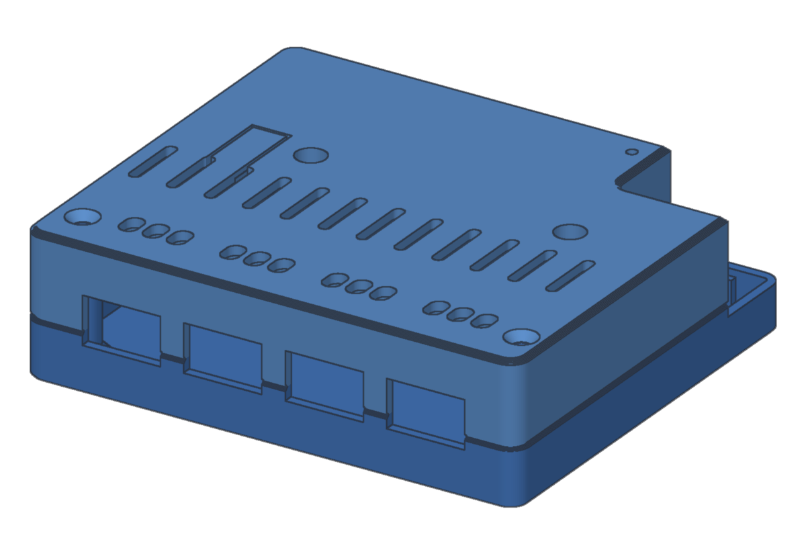
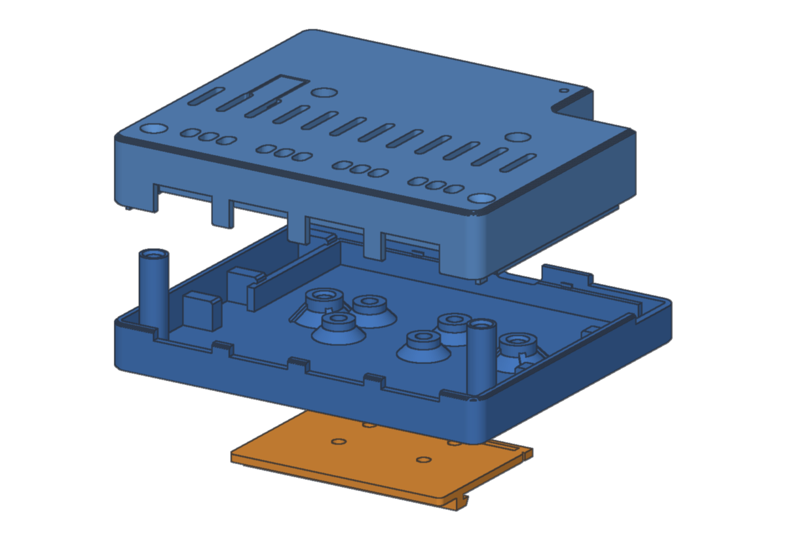
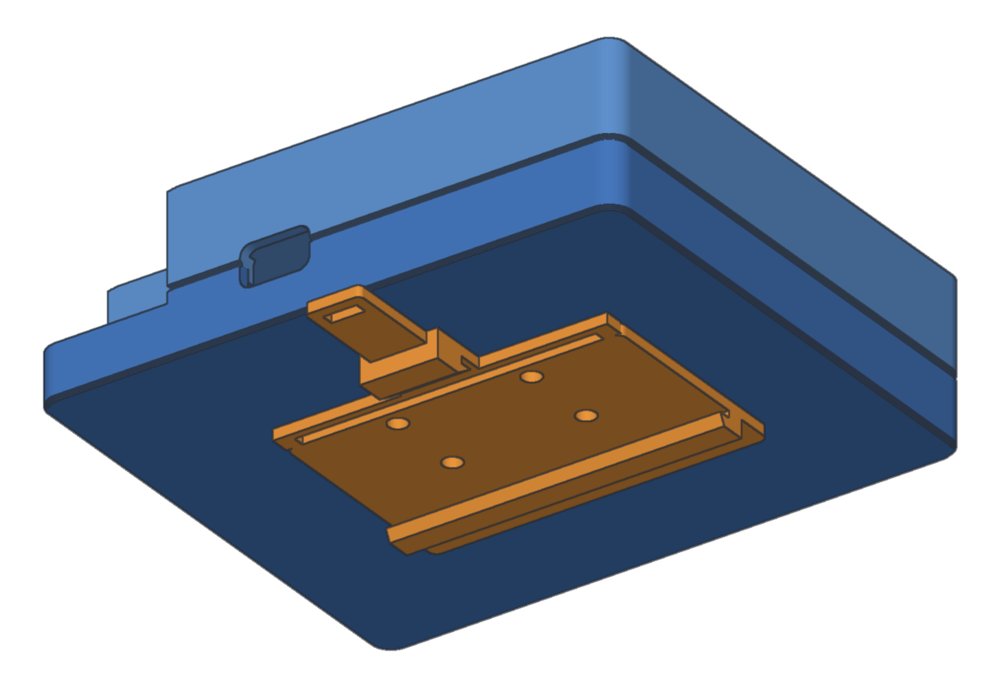
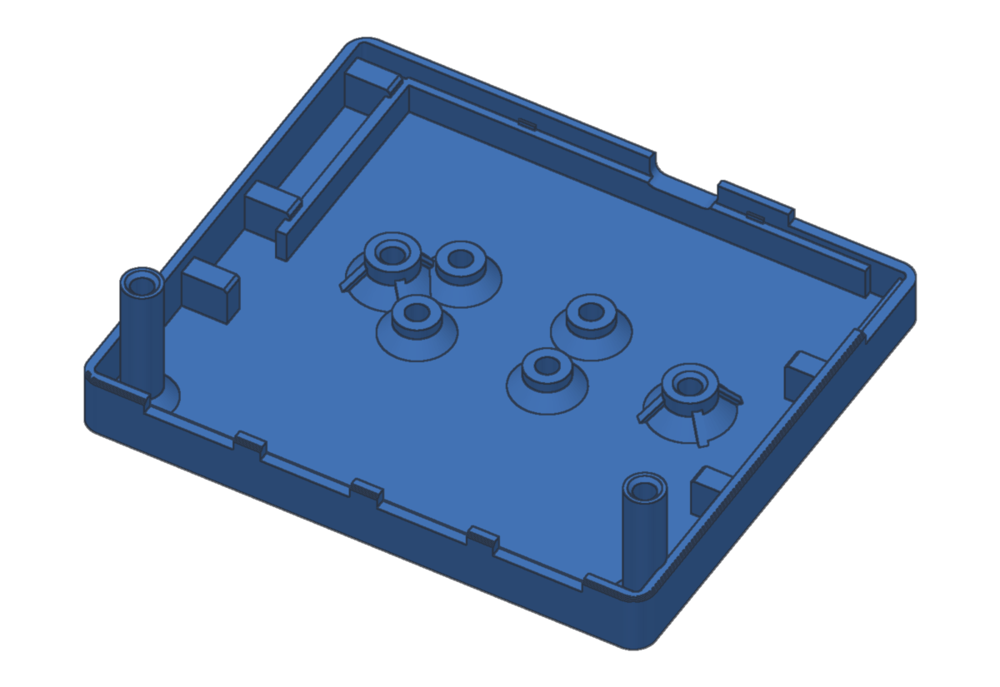
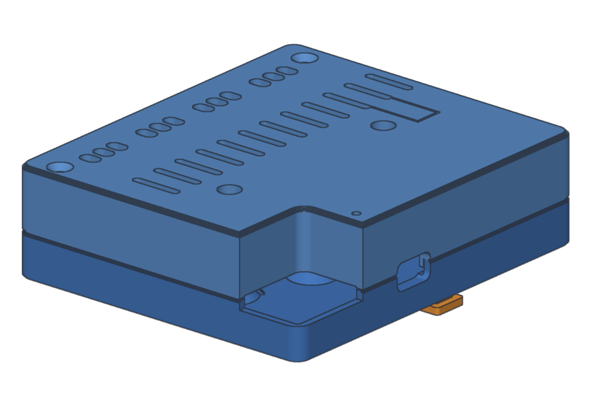
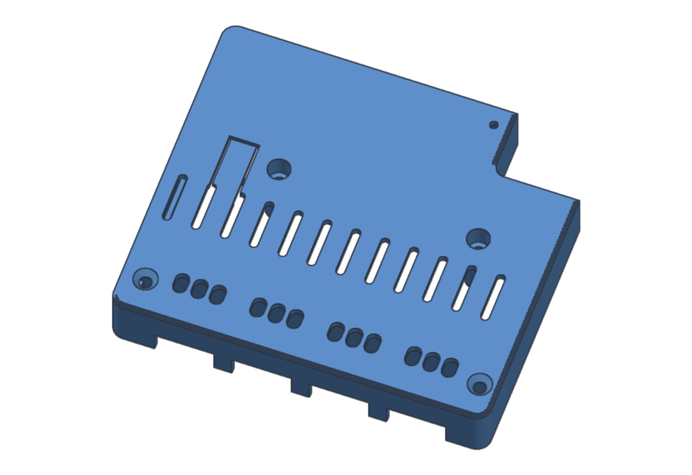
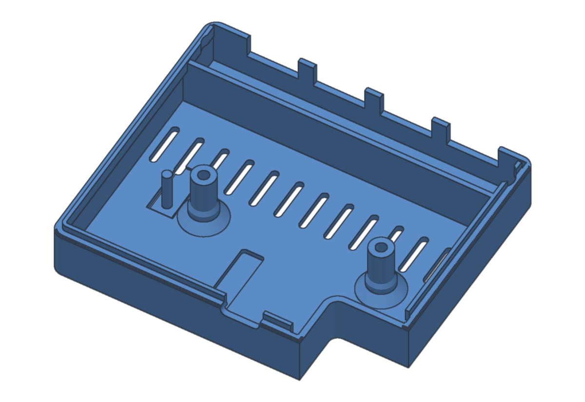
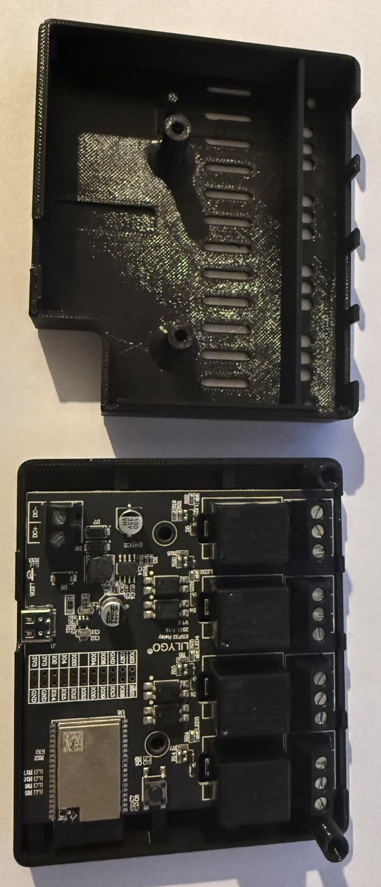
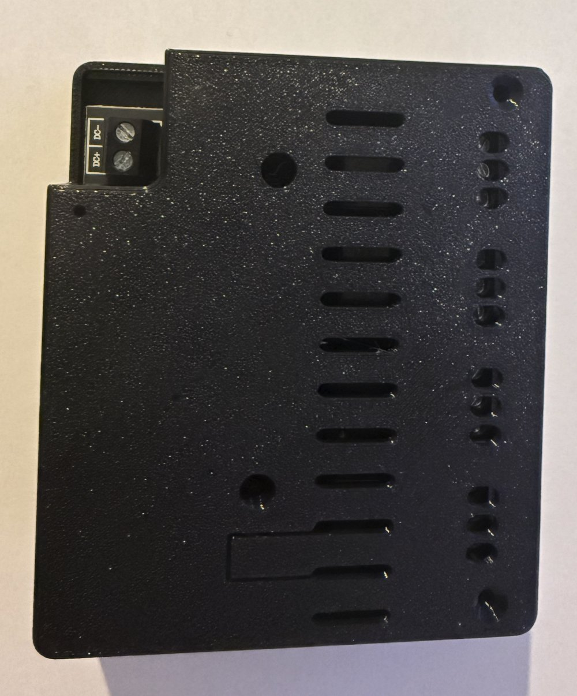

# LilyGO T-Relay (4 relays, ESP32) — DIN-rail enclosure

A 3D-printable enclosure for the **LilyGO T-Relay ESP32, 4 channels** (85 × 85 mm board, ESP32-WROVER module, four 1-Form-C relays with screw terminals). It mounts on a standard **35 mm DIN rail**.

Three parts, all printable without supports.

| | |
|---|---|
|  |  |
|  |  |
|  |  |

## Parts

| File | What it is | Size (mm) | Print orientation |
|---|---|---|---|
| [`stl/base.stl`](stl/base.stl) | Tray: board standoffs, two lid posts, antenna pocket, DIN-clip bosses | 104.5 × 90 × 27.5 (12 without the posts) | floor on the bed, as exported |
| [`stl/lid.stl`](stl/lid.stl) | Deep cover: clamp pillars, vents, terminal screw access, RESET pusher, power-terminal notch | 104.5 × 90 × 19.9 | outer face on the bed, as exported |
| [`stl/din-clip.stl`](stl/din-clip.stl) | 35 mm DIN-rail clip (TS35) with a release tab, screwed under the base | 60 × 69 × 5.2 | flat, as exported |

GitHub shows each STL in an interactive 3D viewer when you open it.

**Assembled size:** 104.5 × 90 × 29.5 mm; about 35 mm deep from the rail, clip included.

**On the rail:** the 104.5 mm side runs along the rail, which takes **6 DIN modules**. The relay terminals face one way off the rail and the power input and USB-C face the other, the side of the clip's release tab.

## What fits where

| Feature | Where | Detail |
|---|---|---|
| Board standoffs | base floor | two, 55.8 mm apart, matching the T-Relay's two Ø4 mm mounting holes; Ø4.0 mm holes for M3 heat-set inserts; the board sits 7.6 mm above the bottom face |
| Board clamp | lid | two pillars land on the board over the standoffs; Ø3.4 mm holes with a Ø6.2 mm counterbore, so one M3 screw per hole holds the board **and** the lid |
| Lid posts | base, two corners on the terminal side | 27.5 mm tall, Ø4.0 mm holes at the top for M3 inserts; countersunk Ø3.4 mm holes in the lid |
| Relay wiring | terminal side | four openings, 16 × 9.5 mm, one per relay (21.4 mm pitch), across the lid/base seam |
| Relay terminal screws | lid, over the terminals | 12 slots, 3.8 × 5.8 mm, in four groups of three (NC / COM / NO, 5.08 mm pitch): tighten the screws with the lid on |
| DC power input | corner notch, power side | 23 × 18 mm cut-out in the lid, open from above and from two sides, down to the base rim, over the 2-pin DC terminal |
| USB-C | power side | 12 × 7 mm opening with rounded corners. We power the board through it at 5 V. The port has no USB-serial chip: flashing needs LilyGO's T-U2T adapter (or a 3.3 V USB-serial adapter) |
| RESET button | lid | a flexible tab (cut on three sides) with a pin underneath that presses the board's RESET button |
| 2 × 11 header (P5) | lid | a 7 × 29 mm panel only 0.4 mm thick, right over the header: leave it closed, or break it out to run wires to the header |
| WiFi antenna | base, antenna side | a 7.5 × 28 mm pocket beside the wall for the module's PCB antenna, which overhangs the board edge by 6.5 mm |
| Vents | lid | 11 slots, 2.4 × 14.4 mm, 8 mm pitch, across the lid between the relays and the logic |
| Small hole | lid, near the power notch | Ø2.2 mm |
| Lid / base joint | rim | locating tabs on the base rim and a skirt on the lid that fills the wall between the relay openings |
| DIN clip | bottom | four bosses, 24 × 14 mm pattern, Ø4.0 mm holes for M3 inserts; the clip has Ø3.4 mm holes |

## Bill of materials

| Qty | Item | Notes |
|---|---|---|
| 1 | LilyGO T-Relay ESP32, 4 channels | relays HuiKe HRS4H-S-DC5V (see **Relay contacts**) |
| 8 | M3 heat-set inserts, Ø4 mm hole | 2 board standoffs, 2 lid posts, 4 clip bosses |
| 2 | M3 × 20 socket or pan head (head ≤ Ø6 mm) | through the lid pillars and the board into the standoffs |
| 2 | M3 × 8 countersunk | lid corners into the lid posts |
| 4 | M3 × 8 pan head | DIN clip to the base |
| 1 | 5 V USB-C supply | how we run ours. The DC terminal is an alternative: check the input range for your board revision |
| — | Ferrules, cable ties | stranded wire in the screw terminals; strain relief outside the box (see below) |

## Printing

- **Material:** PETG or ASA at least, never PLA (it softens near 55 °C, and four relay coils plus a buck converter warm the box). A flame-retardant PETG adds protection; for low-voltage signals plain PETG is enough. Ours are printed in Creality CR-PETG. If a relay switches mains, see **Relay contacts**.
- **Layers:** 0.2 mm, 3 perimeters, 20–25 % infill. The DIN clip and the RESET tab flex: give them 4 perimeters.
- **Supports:** none. The wall openings are notches open at the seam, the vents are slots, and the 0.4 mm header panel is the first layers of the lid.
- **Volume:** about 71 cm³ of solid model for the set, roughly 55–75 g of filament at the settings above.

## Assembly

1. Press the eight M3 inserts in with a soldering iron: two in the board standoffs, two at the top of the lid posts, four in the clip bosses from underneath.
2. Flash the board before closing the box. Programming needs the T-U2T (or a 3.3 V USB-serial adapter), which still plugs into the USB-C opening with the lid on.
3. Lay the board on the standoffs: relay terminals to the four openings, antenna over the pocket, DC terminal under the corner notch.
4. Put the lid on. Fit the two M3 × 20 screws through the pillars and the board's holes into the standoffs, then the two M3 × 8 countersunk screws into the corner posts. Check that the RESET tab clicks the button.
5. Screw the DIN clip under the base, release tab toward the power side.
6. Wire through the openings. Tighten the terminal screws through the slots in the lid.
7. To mount, hook the fixed side of the clip on the rail and press until the tab side snaps over. To remove, pull the release tab with a screwdriver.

## Relay contacts

Each relay is a dry (volt-free) changeover contact, NC/COM/NO, isolated from the board. What it switches is your choice: a clean contact closure for another controller's input, 12/24/48 V DC, or mains.

- **Ratings** (HuiKe HRS4H-S-DC5V datasheet, resistive): 10 A at 120 V AC / 24 V DC; 10 A (NO) / 6 A (NC) at 250 V AC. Derate for motors, pumps and power supplies with inrush; for those, drive a contactor's coil.
- **The enclosure is a housing, not a certification.** The PCB has no isolation slots between relays or between the contacts and the ESP32 side, and the printed parts add none. The screw-access slots keep fingers out, not a tool.
- **If you switch mains:** follow your local wiring rules; fuse each channel; print in a flame-retardant (UL 94 V-0) filament; mount the box behind a cabinet cover; do not mix mains and low voltage on neighbouring relays; tie the cables down within 10 cm of the box.

## Photos

Printed in Creality CR-PETG, powered at 5 V over USB-C.

| | |
|---|---|
|  |  |

## Using it with Multi-Bus Gateway

ESPHome, or any other firmware that publishes the relay states over MQTT, is read through the gateway's MQTT input ([device templates](../../device-templates.md)). Generating and flashing the node firmware for this board from the gateway is part of the ESP nodes service, available in MBG Pro.

## License

[CC BY-SA 4.0](../LICENSE.md): print it, change it, share it, sell it; credit the author and share your changes under the same license.
