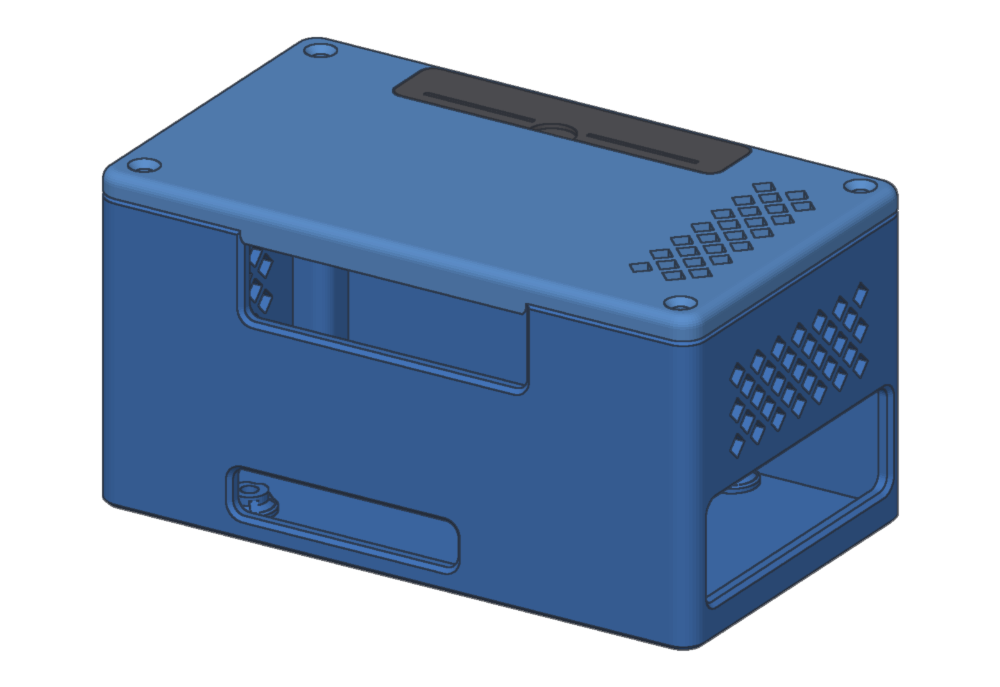
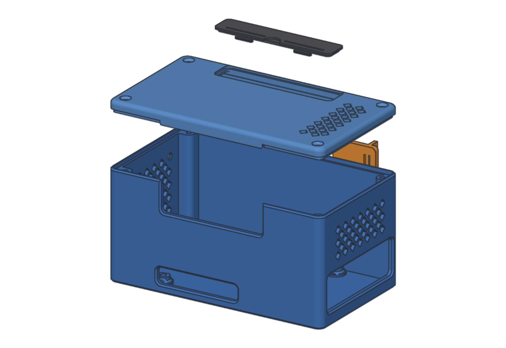
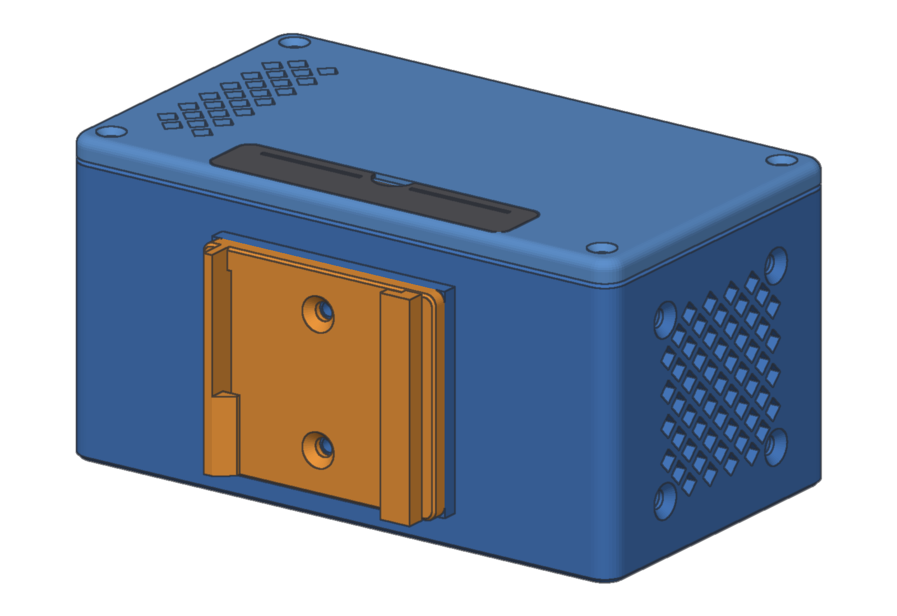
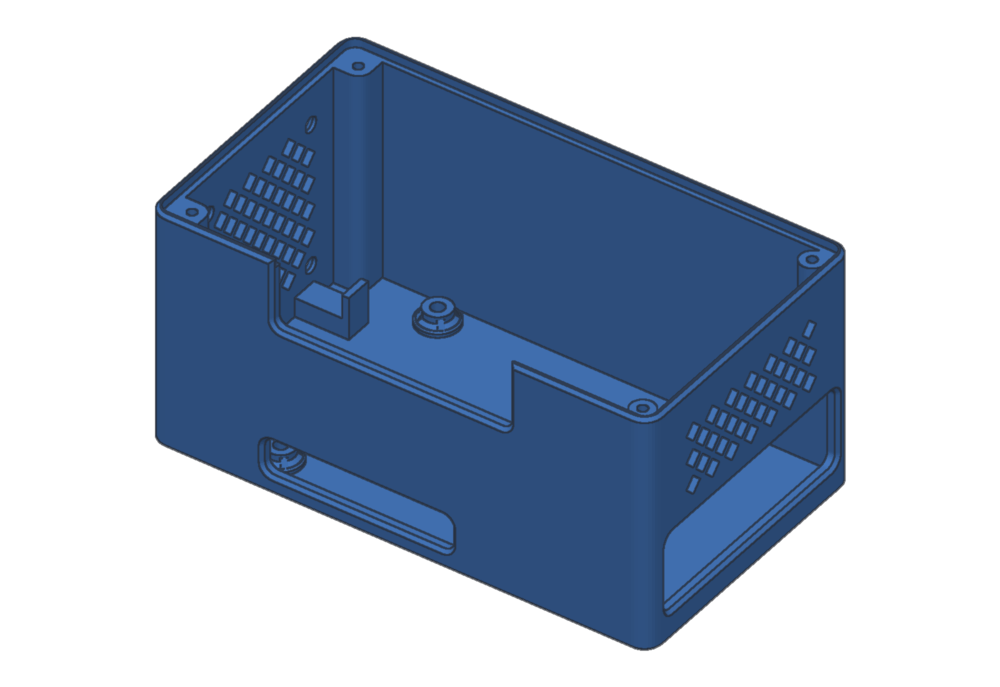
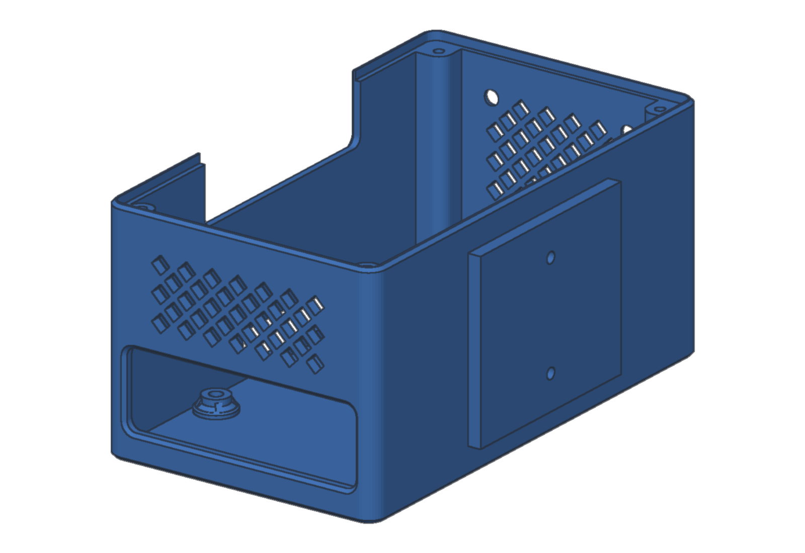
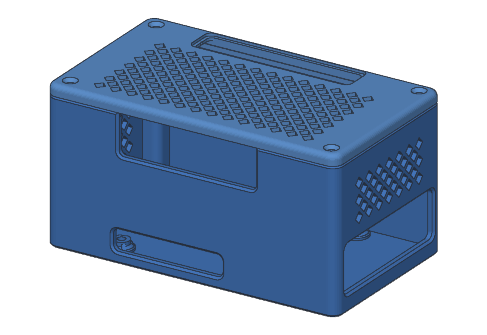
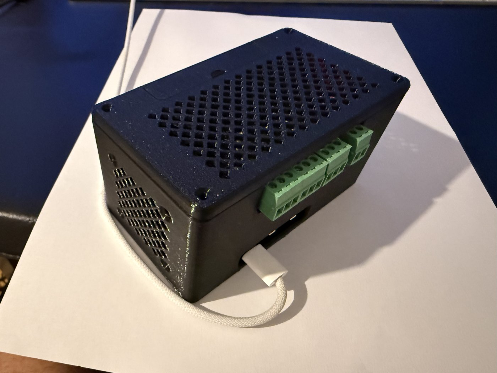
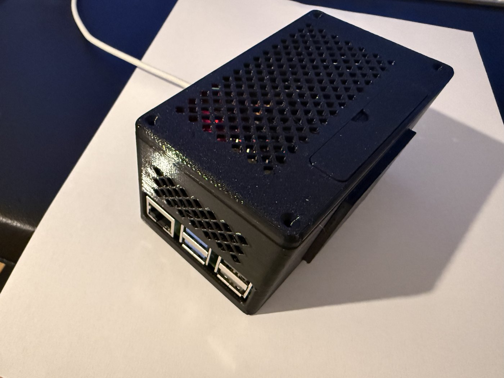
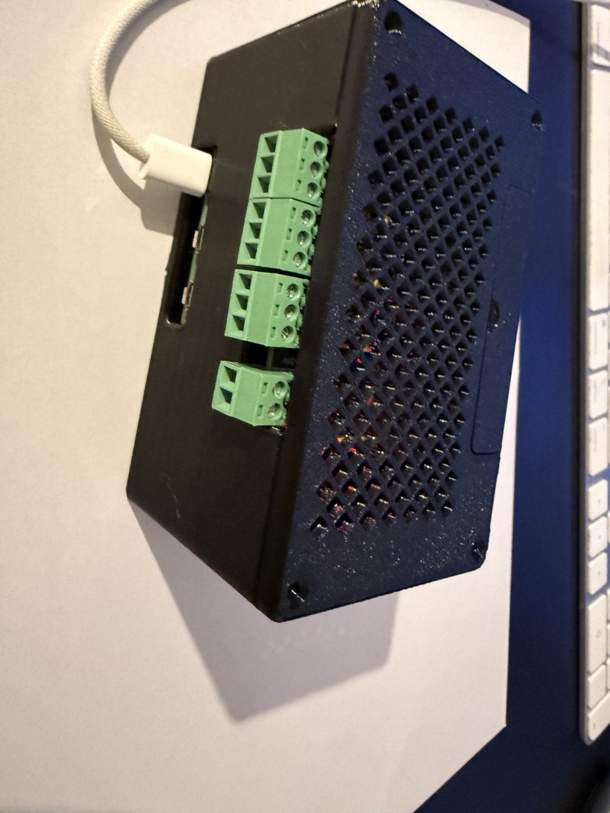
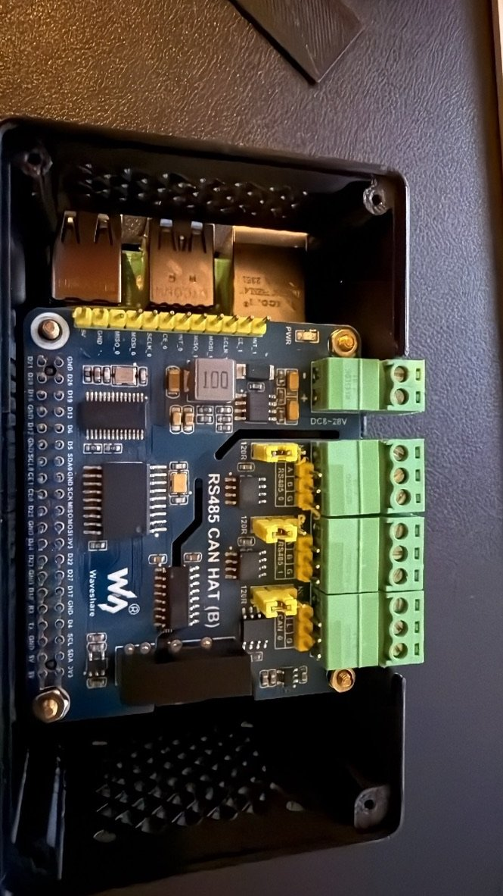

# Raspberry Pi 5 + NVMe HAT + RS485/CAN HAT — DIN-rail enclosure

A 3D-printable enclosure for a gateway built on:

- a **Raspberry Pi 5**;
- an **NVMe HAT**, stacked on top of the Pi;
- the **Waveshare RS485 CAN HAT (B)**, on top of the stack.

It has room for a **40 mm fan** and mounts on a standard **35 mm DIN rail**. It is the hardware we run Multi-Bus Gateway on for RS485 and CAN field buses.

Revision 5. Four parts, all printable without supports.

| | |
|---|---|
|  |  |
|  |  |

## Parts

| File | What it is | Size (mm) | Print orientation |
|---|---|---|---|
| [`stl/body.stl`](stl/body.stl) | Main shell: Pi standoffs, fan wall, port and terminal openings | 110 × 66.5 × 53 | floor on the bed, as exported |
| [`stl/lid.stl`](stl/lid.stl) | Top cover with vents and a slot over the GPIO header | 110 × 63.5 × 6 | outer face on the bed, as exported |
| [`stl/lid-full-vent.stl`](stl/lid-full-vent.stl) | Alternative top cover: vents over the whole lid, no GPIO slot (a closed recess instead), terminal notch left fully open | 110 × 63.5 × 6 | outer face on the bed, as exported |
| [`stl/gpio-cover.stl`](stl/gpio-cover.stl) | Snap-in plate that closes the GPIO slot in the lid | 60 × 12 × 3.6 | flat, as exported |
| [`stl/din-clip.stl`](stl/din-clip.stl) | 35 mm DIN-rail clip (TS35), screwed to the back of the body | 47 × 40 × 7.5 | flat, as exported |

GitHub shows each STL in an interactive 3D viewer when you open it.

### Two lids

Both lids fit the same body, with the same rim and screws:

- **`lid.stl` (standard)** — vents over the SoC, a slot to reach the GPIO
  header (closed by `gpio-cover.stl`), and a tab that closes the top of the
  terminal notch.
- **`lid-full-vent.stl` (more airflow)** — 177 vents across the whole lid,
  for a warm cabinet or a fanless build. There is no GPIO slot or terminal
  tab, and the GPIO cover is not used. The photos below show this lid.

**Assembled size:** 110 × 66.5 × 57 mm. That is 74 mm deep from the rail, clip included.

**On the rail:** the box hangs with its 53 mm side along the rail, which takes **3 DIN modules**.

## What fits where

| Feature | Where | Detail |
|---|---|---|
| Pi 5 standoffs | floor | 58 × 49 mm hole pattern; Ø2.9 mm through-holes with a Ø5 mm counterbore underneath, for M2.5 screws from below; the board sits 5.5 mm above the bed |
| USB-C power, 2 × micro-HDMI | long side | 41 × 8 mm opening along the board edge |
| 2 × USB-A, 2 × USB 3, Ethernet | short side | 54 × 17.6 mm opening |
| RS485 / CAN screw terminals | long side, top | 52 mm wide notch, 15 mm from the top edge, partly closed by a tab on the lid |
| 40 mm fan | short side, opposite the ports | 32 mm square screw pattern, Ø4.1 mm holes, diamond-pattern intake grille; two ribs on the floor keep the fan in place |
| Exhaust | port side and lid | diamond-pattern vents above the ports and in the lid, over the Pi's SoC |
| Lid screws | four corners | Ø2.8 mm through the lid, Ø2.1 mm pilot holes 8 mm deep in the body |
| DIN clip | back | raised pad with two Ø2.5 mm pilot holes, 24 mm apart |

The diamond-shaped vents print without supports. The lid's lip sits about 0.2 mm into a step in the body's rim and has 0.4 mm side clearance, so it centres itself.

## Bill of materials

| Qty | Item | Notes |
|---|---|---|
| 1 | Raspberry Pi 5 | |
| 1 | NVMe HAT + M.2 SSD | sits on top of the Pi, under the RS485/CAN HAT |
| 1 | Waveshare RS485 CAN HAT (B) | top of the stack; its terminals face the notch. Its DC 8–28 V terminal can power the stack from a 12/24 V cabinet supply (check the current limit in Waveshare's documentation); its 120 Ω jumpers set the bus termination |
| 1 | 40 × 40 × 10 mm fan, 5 V | to the Pi 5 fan header (4-pin JST-SH), or to 5 V/GND on the GPIO |
| 4 | M2.5 screws, from below through the floor | into the stack's brass standoffs |
| — | M2.5 brass standoffs (male-female) | between the boards; length depends on the HATs and their headers |
| 4 | M3 × 12–16 + nuts, or fan self-tapping screws | fan |
| 4 | M2.5 × 12 self-tapping screws | lid to body |
| 2 | M3 × 6 countersunk self-tapping screws | DIN clip to body. **Not longer than 6 mm**: the holes go through to the inside, next to the HAT |

## Printing

- **Material:** PETG or ASA. A DIN-rail cabinet in the sun can get hotter than PLA's softening point (about 55 °C).
- **Layers:** 0.2 mm. 3 perimeters, 20–25 % infill. The DIN clip is the part that flexes: give it 4 perimeters.
- **Supports:** none. The two wall openings bridge 41 mm and 54 mm; a tuned printer bridges them cleanly.
- **Volume:** about 80 cm³ of solid model for the whole set, so roughly 70–90 g of filament at the settings above.

## Assembly

1. Flash the system onto the NVMe drive, or onto a microSD card, **before** closing the box. The microSD slot cannot be reached once the Pi is inside.
2. Fit the fan on the inside of the fan wall, blowing **into** the box, and connect it.
3. Build the stack outside the box: Pi 5, standoffs, NVMe HAT, standoffs, RS485/CAN HAT.
4. Lower the stack in, with the ports to the large opening. Screw it from below through the floor.
5. Wire the RS485/CAN terminals through the notch.
6. Put the lid on, screw down the four corners, and click in the GPIO cover.
7. Screw the DIN clip to the back. To mount, hook the fixed side of the clip on the rail and press until the flexing side snaps over. To remove, lever the flexing side with a screwdriver.

**Airflow:** air comes in through the fan and leaves through the vents at the port end and in the lid. Mount the box with the fan at the bottom and the ports at the top, so the fan works with convection rather than against it.

## Photos

The printed enclosure, with the full-vent lid:

| | |
|---|---|
|  |  |
|  |  |

## License

[CC BY-SA 4.0](../LICENSE.md): print it, change it, share it, sell it; credit the author and share your changes under the same license.
